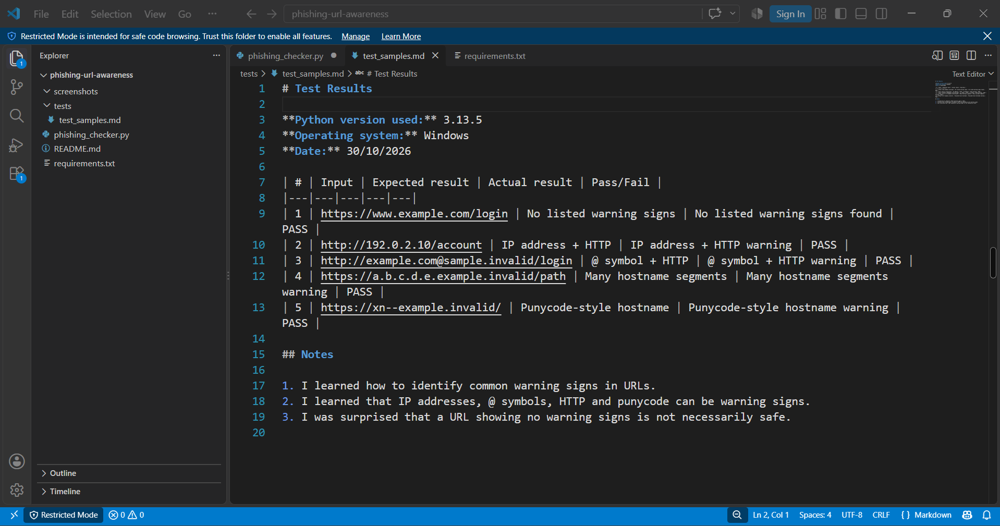

# EWB Phishing URL Awareness Checker

## Overview

Phishing is a common online trick where attackers use fake links to steal personal information like passwords and OTPs. I made this Python program to check URLs and find some common warning signs that may indicate a suspicious link.

The program only checks the URL text. It does not open or visit any website.

## Features

- Detects an @ symbol in the URL.
- Checks if the URL is longer than 100 characters.
- Identifies IP addresses used as hostnames.
- Checks for too many hostname parts (5 or more).
- Detects punycode-style hostnames (xn--).
- Checks whether the URL uses HTTP instead of HTTPS.
- Allows checking multiple URLs without restarting the program.
- Shows a simple explanation for each warning.
- Handles incorrectly formatted URLs without crashing.

## Requirements

- Python 3.10 or later.
- No extra Python packages required.

## How to Run

**Windows:**
```bash
python phishing_checker.py
```

**Mac/Linux:**
```bash
python3 phishing_checker.py
```

## Example Output

```text
EWB Phishing URL Awareness Checker
Text checks only - this program does not open URLs.

Enter a sample URL (or type q to quit):
http://192.0.2.10/account

Result:
- Uses an IP address instead of a familiar domain.
  Reason: An IP address may hide the identity of the actual website.

- Uses HTTP. HTTPS alone does not prove trust.
  Reason: HTTP does not encrypt the connection like HTTPS.

Never enter passwords from unexpected links.
```

## Testing

I tested the program with five sample URLs. All five tests gave the expected results.

| # | Input | Expected | Actual | Result |
|---|---|---|---|---|
| 1 | `https://www.example.com/login` | No warning signs | No listed warning signs found | PASS |
| 2 | `http://192.0.2.10/account` | IP address + HTTP | IP address + HTTP warnings | PASS |
| 3 | `http://example.com@sample.invalid/login` | @ symbol + HTTP | @ symbol + HTTP warnings | PASS |
| 4 | `https://a.b.c.d.e.example.invalid/path` | Many hostname segments | Many hostname segments warning | PASS |
| 5 | `https://xn--example.invalid/` | Punycode-style hostname | Punycode-style hostname warning | PASS |

More details about testing are available in `tests/test_samples.md`.

## Screenshots

### Sample Run
![Sample run] (https://github.com/kundansingh0031/phishing-url-awareness/blob/main/phishing-url-awareness/screenshots/sample_run.png.png )

### Test Results


## Improvements

1. **URL Checking Loop:** Added a while loop so users can check multiple URLs without running the program again. Typing `q` exits the program.

2. **Warning Explanations:** Added a dictionary named `REASONS` to explain why a URL warning is displayed.

3. **Error Handling:** Used try-except to handle incorrectly formatted URLs so the program does not stop unexpectedly.

## Limitations

This project only checks the text of a URL for selected warning signs. It does not open websites, check malware, or connect to any online security service.

A URL showing no warning signs is not necessarily safe.

## Ethical Use

This project is made for learning and cybersecurity awareness. I used the sample URLs provided in the project guide. It should not be used to collect passwords, send phishing links, or test websites without permission.

## Author

Kundan Singh  
EWB Cybersecurity Internship  
EWB Courses
